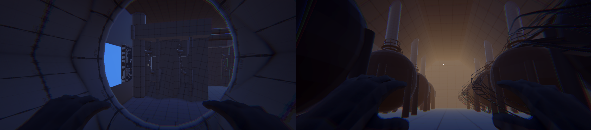
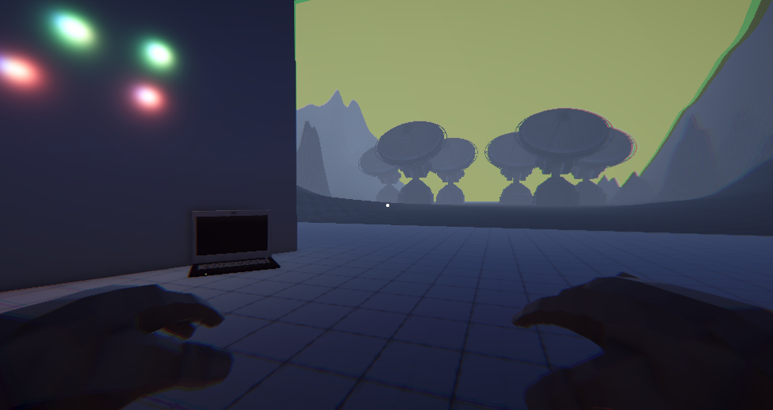

# Far Away

An early first-person psychological horror prototype about surviving alone inside a failing research base on Titan.

**[download the Windows prototype on itch.io](https://ismaelc137.itch.io/far-away)**

> **Project status:** This is an early prototype, far from the final *Far Away* experience. It contains a short playable survival loop to preview the setting and core systems; content and mechanics are incomplete and may have rough edges.

## Quick start

1. Download the Windows build from [itch.io](https://ismaelc137.itch.io/far-away).
2. Extract the full download folder.
3. Run `Far Away.exe` from the extracted folder. Keep it next to its `_Data` folder and the other build files.

## Controls

| Action | Control |
| --- | --- |
| Move | `W` `A` `S` `D` |
| Look | Mouse |
| Sprint | Hold `Left Shift` |
| Crouch | `Left Ctrl` |
| Jump | `Space` |
| Interact | `E` |
| Exit inspection | `Q` |
| Open settings/pause menu | `Tab` |

## What you can do

- Explore the base in first person and interact with its equipment.
- Manage energy and choose between patch, medium, and full machine repairs.
- Sleep to advance a Sol, restore energy, and face new repair requests as damaged systems deteriorate.
- Respond to scheduled mission tasks, including a greenhouse plant task, before their deadlines.
- Try a compact survival loop built around lasting until the rescue window.

## Story

A team of researchers travels to Titan to help terraform the moon. When a storm forces the rest of the crew to evacuate, the protagonist is left alone inside the base. Toxic gas outside makes escape impossible. After sending a distress signal, they must keep the station running and survive until a rescue team arrives, while using mission logs to keep people on Earth invested in bringing them home. The organizations deciding whether to send help may be willing to abandon one stranded researcher.

The intended tone is psychological horror: isolation, mounting anxiety, and the feeling that the base is slowly coming apart. This prototype only offers an early glimpse of that experience.

## Run the project in Unity

- Install Unity Editor **6000.4.9f1** through Unity Hub.
- Open the `Far Away` folder as the Unity project.
- Open `Assets/Scenes/Menu.unity` and press **Play**.

The project uses Unity's Universal Render Pipeline, Input System, and TextMesh Pro. Unity Hub may take a while to import the project the first time.

## How it works

The prototype is built in C# with Unity. `GameManager` tracks energy, Sol progression, mission tasks, and the rescue countdown. Separate machine and event managers handle repair degradation, queued events, and player input during those events. This keeps the current experience focused on a repeatable day-to-day survival loop.

## Credits

- Built with Unity 6, Universal Render Pipeline, Unity Input System, and TextMesh Pro.
